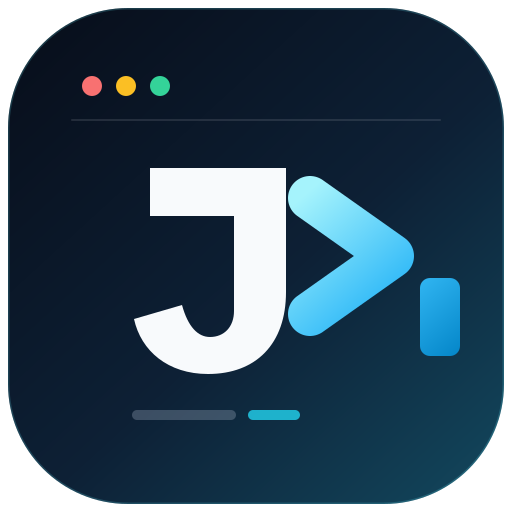
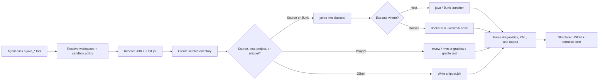

<div align="center">
  
  <h1>dsh-java-runner</h1>
  <p><strong>Real Java execution for DeepSeek Harness agents.</strong></p>
  <p>Compile, run, test, and explore Java with structured diagnostics, JUnit reports,<br />
  Maven/Gradle delegation, one-shot JShell, and optional Docker isolation.</p>

  <p>
    
    
    
    
    
    
    
  </p>

  <p>
    <a href="README.md">English</a> ·
    <a href="README.zh-CN.md">简体中文</a>
  </p>
</div>

> [!NOTE]
> **Alpha status.** All six tools are implemented and covered by a deterministic fake-tool suite plus real JDK integration tests. The plugin is not published on npm yet; load it from a source checkout. Schemas may still change before the probe release.

## Table of contents

- [Why dsh-java-runner?](#why-dsh-java-runner)
- [Tools](#tools)
- [Quick start](#quick-start)
- [Usage](#usage)
- [Docker mode](#docker-mode)
- [How it works](#how-it-works)
- [Configuration](#configuration)
- [Isolation and limits](#isolation-and-limits)
- [Development](#development)
- [Project layout](#project-layout)
- [Roadmap](#roadmap)
- [Contributing](#contributing)
- [License](#license)

## Why dsh-java-runner?

Coding agents can already run `javac` through a shell. The hard part is everything around it: GBK-mangled diagnostics on zh-CN Windows, JUnit classpaths, Maven wrappers, dependency downloads, timeouts, output caps, and process cleanup. `dsh-java-runner` puts that operational knowledge into six tools with stable, structured results.

| | Highlight | What it does |
| --- | --- | --- |
| 🔤 | **UTF-8 and English everywhere** | Pins source encoding, compiler diagnostics, program output, and build-tool locale so agent sessions never decode mojibake. |
| 🧠 | **Diagnostics, not stderr** | Parses javac's machine-readable output into file, line, column, severity, stable code, and message — plus every unparsed line and a coverage ratio. |
| 🧪 | **JUnit 5 without the glue code** | Resolves a pinned console jar, compiles tests, runs class or method selectors, parses XML, and extracts failure stack traces. |
| 🏗️ | **Maven and Gradle aware** | Uses the project wrapper first, falls back to `PATH`, supports offline mode, and finds surefire/Gradle reports across multi-module builds. |
| ⚡ | **JShell for quick experiments** | Runs one script per call with classpath, heap cap, and timeout — no main class, no lingering REPL process. |
| 🐳 | **Optional Docker isolation** | Runs user code with `--network none` by default and mounts only the workspace, scratch directory, JUnit jar, and external classpath entries. |
| 🧹 | **Scratch hygiene** | Every call gets its own directory under `.dsh-java/`; success cleans up, failure retains the directory with an explicit reason. |
| 🛡️ | **Sandbox-aware** | Follows DSH's `read-only`, `workspace-write`, and `danger-full-access` policies and reports the provider's enforcement facts. |

## Tools

| | Tool | Use it for |
| --- | --- | --- |
| 🧭 | `java_env` | See which JDK the plugin resolved and which candidates came from config, `JAVA_HOME`, and `PATH`. |
| 🧱 | `java_compile` | Compile inline or workspace-relative sources and get structured diagnostics. |
| ▶️ | `java_run` | Compile if needed, then run a Java entry point with args, stdin, timeout, and heap cap. |
| 🧪 | `java_test` | Compile sources and run JUnit 5 tests with selectors, totals, and stack traces. |
| 🏗️ | `java_project_test` | Run an existing Maven or Gradle project's test suite through its own build tool. |
| ⚡ | `java_eval` | Evaluate a JShell script with classpath, timeout, and heap cap. |

Docker mode applies to `java_run`, `java_test`, and `java_eval`. Compilation and project builds stay on the host.

## Quick start

### Requirements

| Requirement | Needed for |
| --- | --- |
| DSH 0.2.1.x | Everything; verified with 0.2.1-rc.5 |
| JDK 17 or newer | All host-side tools; JDK 17 is verified locally |
| A full JDK with `jshell` | `java_eval` without Docker |
| Maven or Gradle, or a project wrapper | `java_project_test` |
| Docker with a pulled image | `dockerImage` mode |
| Network access | First `java_test` unless the JUnit jar is already in `~/.m2` or the verified host cache |

Windows and Linux are the primary targets. macOS is best-effort.

### Install from a source checkout

```sh
cd /path/to/dsh-java-runner
pnpm install
pnpm build
```

### Load it in DSH Desktop

Add a `link:` dependency to `~/.dsh/profiles/desktop/package.json` and register the bundle:

```jsonc
{
  "dependencies": {
    // ... existing dependencies
    "dsh-java-runner": "link:/absolute/path/to/dsh-java-runner"
  },
  "dsh": {
    "profile": {
      "bundles": [
        // ... existing bundles
        "dsh-java-runner"
      ]
    }
  }
}
```

Run the profile install with the pnpm bundled with the desktop app, then restart the app. Verify the toolchain:

> **You:** Run `java_env` and tell me which JDK the Java tools will use.

## Usage

The agent picks the tool; you usually just describe the outcome.

### Compile and run

> **You:** Write and run a Java program that prints the sum of 1 to 100.

Result excerpt:

```json
{
  "success": true,
  "exitCode": 0,
  "stdout": "5050\n",
  "stderr": "",
  "compile": {
    "success": true,
    "diagnostics": []
  }
}
```

### Diagnose a compile error

> **You:** Why doesn't `int x = "42";` compile?

Result excerpt:

```json
{
  "success": false,
  "diagnostics": [
    {
      "file": "Main.java",
      "line": 2,
      "column": 21,
      "severity": "error",
      "code": "compiler.err.prob.found.req",
      "message": "incompatible types: String cannot be converted to int"
    }
  ],
  "unknownLines": [],
  "coverage": 1
}
```

The rendered text also points at the source line, and any compiler output the parser does not recognize is returned verbatim instead of being silently dropped.

### Run JUnit 5 tests

> **You:** Run `CalculatorTest` and explain the failing test.

Result excerpt:

```json
{
  "success": false,
  "total": 2,
  "passed": 1,
  "failed": 1,
  "skipped": 0,
  "failures": [
    {
      "test": "CalculatorTest.adds",
      "message": "expected: <5> but was: <4>",
      "stackTrace": "..."
    }
  ]
}
```

A run that discovers no tests is a failure, and a compile error is returned without starting the JUnit process.

### Delegate to Maven or Gradle

> **You:** Run the tests in `backend/`. Use the wrapper if the project has one.

Result excerpt:

```json
{
  "system": "maven",
  "wrapper": true,
  "total": 24,
  "passed": 23,
  "failed": 1,
  "reportFiles": 3
}
```

A build that produces no test reports is reported as a failure with the build output and guidance, never as a green run.

### Evaluate with JShell

> **You:** Use JShell to print the first five square numbers.

Result excerpt:

```json
{
  "success": true,
  "stdout": "1\n4\n9\n16\n25\n",
  "errors": []
}
```

> [!TIP]
> JShell does not print bare expression values in script mode. Wrap visible output in `System.out.println(...)`. JShell also exits with code 0 when snippets fail, so `java_eval` scans stderr for `Error:` and exception lines and returns `success: false` when it finds them.

## Docker mode

Set `dockerImage` to move user code into a container. Compilation and `java_project_test` stay on the host.

```yaml
# ~/.dsh/profiles/desktop/cordis.patch.yml
- id: dsh-java-runner
  name: dsh-java-runner
  config:
    dockerImage: eclipse-temurin:17-jdk
    dockerNetwork: none
```

The image must contain `java`; `java_eval` also needs `jshell`. On timeout or abort, the plugin best-effort runs `docker rm --force` because stopping the CLI does not always stop the container.

| Host path | Container path | Mode |
| --- | --- | --- |
| Session workspace | `/workspace` | `ro` under `read-only`, otherwise `rw` |
| Per-call scratch directory | `/dsh-work` | `rw` |
| JUnit console jar | `/dsh-libs/junit.jar` | `ro` |
| External classpath entries | `/dsh-libs/cp-N` | `ro` |

No host environment variables are passed into the container; the plugin adds no `-e` flags. Classpath entries are rewritten to container paths, and URL or wildcard classpath entries are rejected because they cannot be mapped deterministically.

> [!WARNING]
> Docker is an optional extra boundary, not a complete sandbox. It prevents network access when `dockerNetwork` is `none`, but fork bombs and host resource exhaustion are still possible. Do not run untrusted code in a privileged session.

## How it works



Every subprocess goes through DSH's subprocess seam, so timeouts abort the provider's managed process range and the sandbox policy is applied consistently. The plugin does not provide a sandbox backend.

## Configuration

Host configuration is read from the plugin row in the DSH profile.

| Key | Type | Default | Purpose |
| --- | --- | --- | --- |
| `javaHome` | string? | auto-detect | Select a JDK |
| `javacPath` | string? | auto-detect | Override the compiler executable |
| `timeoutMs` | number | `15000` | Default execution timeout |
| `buildTimeoutMs` | number | `120000` | Default `java_project_test` timeout |
| `maxHeapMb` | number | `256` | Default `-Xmx` |
| `scratchRoot` | string? | `<workspace>/.dsh-java` | Scratch directory root |
| `junitJarPath` | string? | m2 → verified cache → download | JUnit console launcher jar |
| `dockerImage` | string? | unset | Run `java_run`, `java_test`, and `java_eval` user code in this image |
| `dockerNetwork` | `none` \| `bridge` | `none` | Network mode for the execution container |

Override values in the profile patch:

```yaml
# ~/.dsh/profiles/desktop/cordis.patch.yml
- id: dsh-java-runner
  name: dsh-java-runner
  config:
    timeoutMs: 20000
    maxHeapMb: 512
    # junitJarPath: /absolute/path/junit-platform-console-standalone.jar
    # dockerImage: eclipse-temurin:17-jdk
    # dockerNetwork: none
```

The JUnit console jar resolves in this order: `junitJarPath` → `~/.m2` → a SHA-256-verified host cache at `~/.dsh-java-runner/junit/` → a verified Maven Central download. Offline machines should set `junitJarPath` or rely on m2.

## Isolation and limits

| Layer | Provided by | Behavior |
| --- | --- | --- |
| File writes | DSH sandbox | `read-only` / `workspace-write`; `danger-full-access` bypasses confinement |
| Time | Plugin | `timeoutMs`; aborts the provider's managed process range and force-removes Docker containers |
| Heap | Plugin | `-Xmx` |
| Directory | Plugin | Per-call scratch directory, deleted on success or retained with a reason |
| Output | Plugin | In-memory caps plus 8 MiB spill files; truncation is explicit |
| Source reads | Plugin | Inline content or paths contained by the session workspace |
| Unicode class names | Host JDK launcher | Passed through the native command line; on Windows, a name outside the active code page fails before Java starts. Source text, diagnostics, and output stay UTF-8. |
| Network on host | Not isolated | Java code can open sockets |
| Network in Docker | Docker, optional | `dockerNetwork: none` by default; set `bridge` to opt in |
| Fork bombs | Not prevented | Applies to host and container execution |

## Development

```sh
pnpm install
pnpm typecheck
pnpm test
pnpm build
```

| Suite | Requires | Covers |
| --- | --- | --- |
| Fake-tool suite | Nothing | Compile, run, JUnit, project detection, JShell, Docker argv/mounts/cleanup, sandbox paths |
| Real JDK suite | JDK 17+ | Compilation, Unicode I/O, timeout, heap cap, sandbox confinement, real JUnit and JShell runs |
| Desktop acceptance | Maven, Gradle, Docker daemon | Real project builds and real container execution; not part of CI |

`pnpm test` runs 80 tests. Real JDK cases skip automatically when `javac` is unavailable; `java_test` cases also need JDK 17+ and a resolvable JUnit jar, and `java_eval` cases need `jshell`.

CI runs typecheck, tests, and build on Ubuntu and Windows without installing a JDK. The fake-tool suite is the CI safety net; Maven, Gradle, and Docker validation is documented as a desktop acceptance step.

## Project layout

```text
src/
├── index.ts          # plugin entry, registers the six tools
├── config.ts         # Schemastery configuration
├── jdk.ts            # JDK discovery and probing
├── inputs.ts         # workspace boundary and scratch directories
├── compile.ts        # javac pipeline
├── run.ts            # host and Docker Java execution
├── junit.ts          # JUnit launcher
├── junit-jar.ts      # verified console-jar acquisition
├── project.ts        # Maven/Gradle delegation and report discovery
├── eval.ts           # one-shot JShell
├── docker.ts         # container execution and path mapping
├── proc.ts           # sandboxed subprocess runner
├── parsers/          # javac diagnostics and JUnit XML
└── tools/            # tool definitions and rendering
test/                 # fake-tool harness and real JDK integration tests
docs/adr/             # architecture decision records
```

## Roadmap

- [x] **Phase 1** — JDK discovery, `java_compile`, `java_run`, sandbox integration.
- [x] **Phase 2** — `java_test` with a pinned JUnit console jar.
- [x] **Phase 3** — `java_project_test`, `java_eval`, optional Docker execution.
- [ ] Desktop acceptance with real Maven, Gradle, and Docker environments.
- [ ] Probe release on npm.

## Contributing

Issues and pull requests are welcome. For behavior changes, add a fake-tool test; for architectural decisions, record an ADR under [`docs/adr/`](docs/adr/). If this plugin saves you a debugging round, a ⭐ helps other DSH users find it.

## License

[MIT](LICENSE) © dsh-java-runner contributors

<div align="center">
  <sub>Built for <a href="https://deepseek-harness.github.io/deepseek-harness/">DeepSeek Harness</a>. Not affiliated with Oracle or the OpenJDK project.</sub>
</div>
