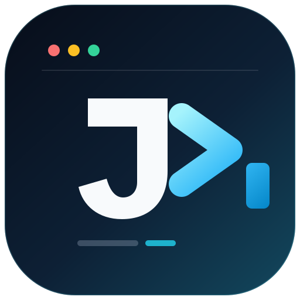
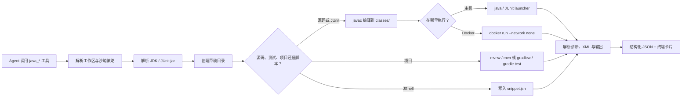

<div align="center">
  
  <h1>dsh-java-runner</h1>
  <p><strong>给 DeepSeek Harness Agent 真正的 Java 执行能力。</strong></p>
  <p>编译、运行、测试与探索 Java：结构化诊断、JUnit 报告、<br />
  Maven/Gradle 委托、单次 JShell，以及可选的 Docker 隔离。</p>

  <p>
    
    
    
    
    
    
    
  </p>

  <p>
    <a href="README.md">English</a> ·
    <a href="README.zh-CN.md">简体中文</a>
  </p>
</div>

> [!NOTE]
> **Alpha 状态。** 六个工具均已实现，并通过确定性的 fake 工具测试与本机 JDK 集成测试。插件尚未发布到 npm，请从源码加载；探测版之前 schema 仍可能变化。

## 目录

- [为什么选择 dsh-java-runner](#为什么选择-dsh-java-runner)
- [工具](#工具)
- [快速开始](#快速开始)
- [使用示例](#使用示例)
- [Docker 模式](#docker-模式)
- [工作原理](#工作原理)
- [配置](#配置)
- [隔离与限制](#隔离与限制)
- [开发](#开发)
- [项目结构](#项目结构)
- [路线图](#路线图)
- [参与贡献](#参与贡献)
- [License](#license)

## 为什么选择 dsh-java-runner

Agent 本来就能通过 shell 调用 `javac`，真正难的是它周围的一切：中文 Windows 下的 GBK 乱码诊断、JUnit classpath、Maven wrapper、依赖下载、超时、输出上限和进程清理。`dsh-java-runner` 把这些工程细节收进六个工具，统一返回稳定的结构化结果。

| | 亮点 | 说明 |
| --- | --- | --- |
| 🔤 | **统一 UTF-8 与英文 locale** | 固定源码编码、编译诊断、程序输出和构建工具 locale，Agent 会话不再解出乱码。 |
| 🧠 | **结构化诊断，而非原始 stderr** | 把 javac 的机器可读输出解析为文件、行、列、严重级别、稳定代码和消息，同时返回所有未解析行与覆盖率。 |
| 🧪 | **不用手拼 JUnit** | 自动解析固定版本的 console jar、编译测试、按类或方法选择、解析 XML，并提取失败堆栈。 |
| 🏗️ | **理解 Maven 与 Gradle** | 优先使用项目 wrapper，其次回退 `PATH`；支持离线模式；能在多模块工程中找到 surefire/Gradle 报告。 |
| ⚡ | **JShell 做快速实验** | 每次调用执行一个脚本，支持 classpath、堆上限和超时——不需要 main 方法，也不会留下常驻 REPL 进程。 |
| 🐳 | **可选的 Docker 隔离** | 用户代码默认 `--network none`，只挂载工作区、草稿目录、JUnit jar 和外部 classpath 条目。 |
| 🧹 | **草稿目录卫生** | 每次调用在 `.dsh-java/` 下有独立目录；成功清理，失败保留并给出明确原因。 |
| 🛡️ | **感知 DSH 沙箱** | 遵循 `read-only`、`workspace-write` 和 `danger-full-access` 策略，并返回 provider 的执行事实。 |

## 工具

| | 工具 | 用途 |
| --- | --- | --- |
| 🧭 | `java_env` | 查看插件最终选用的 JDK，以及来自 config、`JAVA_HOME`、`PATH` 的候选。 |
| 🧱 | `java_compile` | 编译内联或工作区相对路径源码，返回结构化诊断。 |
| ▶️ | `java_run` | 按需编译，再运行 Java 入口，支持参数、stdin、超时和堆上限。 |
| 🧪 | `java_test` | 编译源码并运行 JUnit 5 测试，支持选择器、统计和失败堆栈。 |
| 🏗️ | `java_project_test` | 通过项目自身的 Maven 或 Gradle 构建工具运行测试套件。 |
| ⚡ | `java_eval` | 执行 JShell 脚本，支持 classpath、超时和堆上限。 |

Docker 模式适用于 `java_run`、`java_test` 和 `java_eval`；编译与项目构建仍留在主机。

## 快速开始

### 环境要求

| 要求 | 用途 |
| --- | --- |
| DSH 0.2.1.x | 全部功能；已在 0.2.1-rc.5 验证 |
| JDK 17 或更新 | 所有主机侧工具；本机已验证 JDK 17 |
| 包含 `jshell` 的完整 JDK | 主机模式下的 `java_eval` |
| Maven 或 Gradle，或项目自带 wrapper | `java_project_test` |
| 已拉取镜像的 Docker | `dockerImage` 模式 |
| 网络访问 | 首次 `java_test`；如果 JUnit jar 已在 `~/.m2` 或校验缓存中则不需要 |

主要支持 Windows 与 Linux；macOS 为 best-effort。

### 从源码安装

```sh
cd /path/to/dsh-java-runner
pnpm install
pnpm build
```

### 在 DSH Desktop 中加载

在 `~/.dsh/profiles/desktop/package.json` 中添加 `link:` 依赖，并登记 bundle：

```jsonc
{
  "dependencies": {
    // ... 现有依赖
    "dsh-java-runner": "link:/absolute/path/to/dsh-java-runner"
  },
  "dsh": {
    "profile": {
      "bundles": [
        // ... 现有 bundles
        "dsh-java-runner"
      ]
    }
  }
}
```

使用桌面应用自带的 pnpm 完成 profile 安装，然后重启应用。验证工具链：

> **你：** 运行 `java_env`，告诉我 Java 工具最终会使用哪个 JDK。

## 使用示例

工具通常由 Agent 自动选择，你只需要描述目标。

### 编译与运行

> **你：** 写一个 Java 程序，打印 1 到 100 的和，并运行给我看。

结果节选：

```json
{
  "success": true,
  "exitCode": 0,
  "stdout": "5050\n",
  "stderr": "",
  "compile": {
    "success": true,
    "diagnostics": []
  }
}
```

### 诊断编译错误

> **你：** 为什么 `int x = "42";` 编译不过？

结果节选：

```json
{
  "success": false,
  "diagnostics": [
    {
      "file": "Main.java",
      "line": 2,
      "column": 21,
      "severity": "error",
      "code": "compiler.err.prob.found.req",
      "message": "incompatible types: String cannot be converted to int"
    }
  ],
  "unknownLines": [],
  "coverage": 1
}
```

渲染文本会同时指向源码位置；解析器无法识别的编译器输出会原样返回，而不是被静默丢弃。

### 运行 JUnit 5 测试

> **你：** 运行 `CalculatorTest`，解释失败的测试。

结果节选：

```json
{
  "success": false,
  "total": 2,
  "passed": 1,
  "failed": 1,
  "skipped": 0,
  "failures": [
    {
      "test": "CalculatorTest.adds",
      "message": "expected: <5> but was: <4>",
      "stackTrace": "..."
    }
  ]
}
```

没有发现任何测试会被判为失败；编译失败时不会启动 JUnit 进程。

### 委托 Maven 或 Gradle

> **你：** 运行 `backend/` 下的测试；如果项目有 wrapper 就用 wrapper。

结果节选：

```json
{
  "system": "maven",
  "wrapper": true,
  "total": 24,
  "passed": 23,
  "failed": 1,
  "reportFiles": 3
}
```

如果构建成功但没有产生任何测试报告，工具会返回失败，并附带构建输出和排查提示，而不是误报为通过。

### 使用 JShell 做快速实验

> **你：** 用 JShell 打印前五个平方数。

结果节选：

```json
{
  "success": true,
  "stdout": "1\n4\n9\n16\n25\n",
  "errors": []
}
```

> [!TIP]
> JShell 在脚本模式下不会打印裸表达式的值，需要可见输出时请使用 `System.out.println(...)`。另外，JShell 在代码出错时仍返回退出码 0，因此 `java_eval` 会扫描 stderr 中的 `Error:` 和异常行；发现错误时返回 `success: false`。

## Docker 模式

设置 `dockerImage` 后，用户代码进入容器执行；编译与 `java_project_test` 仍留在主机。

```yaml
# ~/.dsh/profiles/desktop/cordis.patch.yml
- id: dsh-java-runner
  name: dsh-java-runner
  config:
    dockerImage: eclipse-temurin:17-jdk
    dockerNetwork: none
```

镜像必须包含 `java`；`java_eval` 还需要 `jshell`。超时或中止后，插件会尽力执行 `docker rm --force`，因为停止 CLI 不一定能停止容器。

| 主机路径 | 容器路径 | 模式 |
| --- | --- | --- |
| 会话工作区 | `/workspace` | `read-only` 下为 `ro`，否则为 `rw` |
| 本次调用的草稿目录 | `/dsh-work` | `rw` |
| JUnit console jar | `/dsh-libs/junit.jar` | `ro` |
| 外部 classpath 条目 | `/dsh-libs/cp-N` | `ro` |

容器不会继承主机环境变量；插件不会添加任何 `-e` 参数。classpath 条目会重写为容器路径；URL 和通配符 classpath 无法确定映射，因此会被拒绝。

> [!WARNING]
> Docker 是可选附加边界，不是完整沙箱。`dockerNetwork: none` 能阻止网络访问，但仍无法防止 fork 炸弹或主机资源耗尽。不要在特权会话中运行不可信代码。

## 工作原理



所有子进程都经过 DSH 的 subprocess seam，因此超时会中止 provider 管理的进程范围，沙箱策略也保持一致。插件本身不提供沙箱后端。

## 配置

Host 配置来自 DSH profile 中的插件行。

| 键 | 类型 | 默认值 | 用途 |
| --- | --- | --- | --- |
| `javaHome` | string? | 自动探测 | 指定 JDK |
| `javacPath` | string? | 自动探测 | 覆盖编译器可执行文件 |
| `timeoutMs` | number | `15000` | 默认执行超时 |
| `buildTimeoutMs` | number | `120000` | `java_project_test` 默认超时 |
| `maxHeapMb` | number | `256` | 默认 `-Xmx` |
| `scratchRoot` | string? | `<workspace>/.dsh-java` | 草稿目录根路径 |
| `junitJarPath` | string? | m2 → 校验缓存 → 下载 | JUnit console launcher jar |
| `dockerImage` | string? | 未设置 | 在镜像中运行 `java_run`、`java_test`、`java_eval` 的用户代码 |
| `dockerNetwork` | `none` \| `bridge` | `none` | 执行容器的网络模式 |

在 profile patch 中覆盖配置：

```yaml
# ~/.dsh/profiles/desktop/cordis.patch.yml
- id: dsh-java-runner
  name: dsh-java-runner
  config:
    timeoutMs: 20000
    maxHeapMb: 512
    # junitJarPath: /absolute/path/junit-platform-console-standalone.jar
    # dockerImage: eclipse-temurin:17-jdk
    # dockerNetwork: none
```

JUnit console jar 的解析顺序：`junitJarPath` → `~/.m2` → `~/.dsh-java-runner/junit/` 下经 SHA-256 校验的主机缓存 → 从 Maven Central 下载并校验。离线环境应设置 `junitJarPath` 或依赖 m2。

## 隔离与限制

| 层 | 提供方 | 行为 |
| --- | --- | --- |
| 文件写入 | DSH sandbox | `read-only` / `workspace-write`；`danger-full-access` 绕过限制 |
| 时间 | 插件 | `timeoutMs`；中止 provider 管理的进程范围，并强制删除 Docker 容器 |
| 内存 | 插件 | `-Xmx` |
| 目录 | 插件 | 每次调用独立草稿目录；成功删除，失败保留并说明原因 |
| 输出 | 插件 | 内存上限 + 8 MiB spill 文件；截断状态显式返回 |
| 源码读取 | 插件 | 内联内容，或受限于会话工作区的路径 |
| 主机网络 | 不隔离 | Java 代码可以建立网络连接 |
| Docker 网络 | Docker，可选 | 默认 `dockerNetwork: none`；设为 `bridge` 才放行 |
| fork 炸弹 | 不防 | 主机与容器执行均适用 |

## 开发

```sh
pnpm install
pnpm typecheck
pnpm test
pnpm build
```

| 测试套件 | 依赖 | 覆盖内容 |
| --- | --- | --- |
| fake 工具测试 | 无 | 编译、运行、JUnit、项目识别、JShell、Docker argv/挂载/清理、沙箱路径 |
| 真实 JDK 测试 | JDK 17+ | 编译、Unicode I/O、超时、堆上限、沙箱限制、真实 JUnit 与 JShell |
| 桌面验收 | Maven、Gradle、Docker daemon | 真实项目构建与真实容器执行；不属于 CI |

`pnpm test` 共 80 个测试。没有 `javac` 时真实 JDK 用例会自动跳过；`java_test` 用例还需要 JDK 17+ 和可解析的 JUnit jar，`java_eval` 用例需要 `jshell`。

CI 在 Ubuntu 和 Windows 上运行 typecheck、测试和构建，无需安装 JDK。fake 工具测试是 CI 的安全网；Maven、Gradle 和 Docker 的验证记录为桌面验收步骤。

## 项目结构

```text
src/
├── index.ts          # 插件入口，注册六个工具
├── config.ts         # Schemastery 配置
├── jdk.ts            # JDK 发现与探测
├── inputs.ts         # 工作区边界与草稿目录
├── compile.ts        # javac 编译管线
├── run.ts            # 主机与 Docker 的 Java 执行
├── junit.ts          # JUnit launcher
├── junit-jar.ts      # 校验并获取 console jar
├── project.ts        # Maven/Gradle 委托与报告发现
├── eval.ts           # 单次 JShell
├── docker.ts         # 容器执行与路径映射
├── proc.ts           # 受沙箱约束的 subprocess runner
├── parsers/          # javac 诊断与 JUnit XML
└── tools/            # 工具定义与渲染
test/                 # fake 工具测试与真实 JDK 集成测试
docs/adr/             # 架构决策记录
```

## 路线图

- [x] **Phase 1** — JDK 发现、`java_compile`、`java_run`、沙箱集成。
- [x] **Phase 2** — 固定版本 JUnit console jar 的 `java_test`。
- [x] **Phase 3** — `java_project_test`、`java_eval`、可选 Docker 执行。
- [ ] 在真实 Maven、Gradle 和 Docker 环境中完成桌面验收。
- [ ] 发布 npm 探测版。

## 参与贡献

欢迎提交 issue 和 pull request。行为变更请补充 fake 工具测试；架构决策请记录到 [`docs/adr/`](docs/adr/)。如果这个插件帮你省下了一轮 `javac` 调试，欢迎点一个 ⭐，让更多 DSH 用户找到它。

## License

[MIT](LICENSE) © dsh-java-runner contributors

<div align="center">
  <sub>为 <a href="https://deepseek-harness.github.io/deepseek-harness/">DeepSeek Harness</a> 构建。与 Oracle 或 OpenJDK 项目无隶属关系。</sub>
</div>
